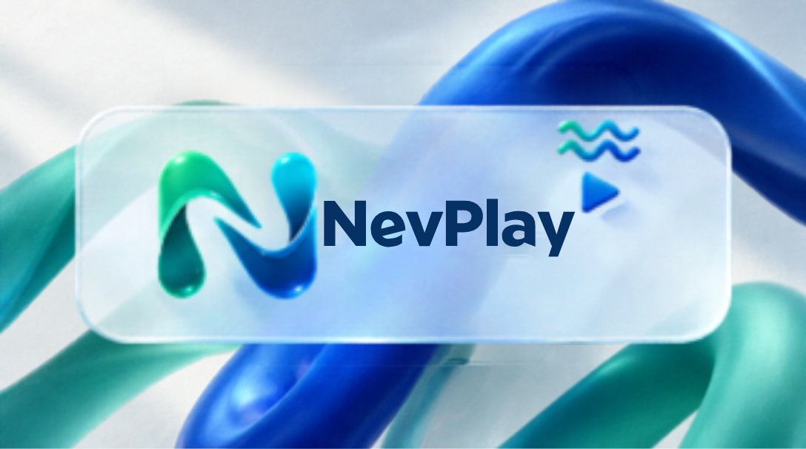
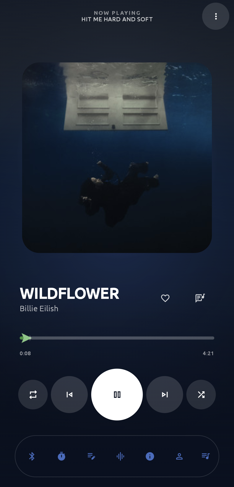
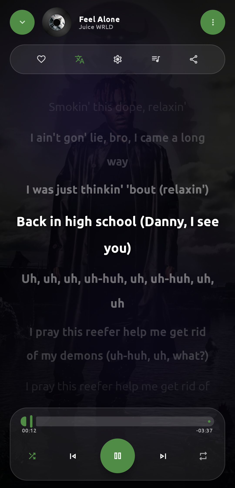
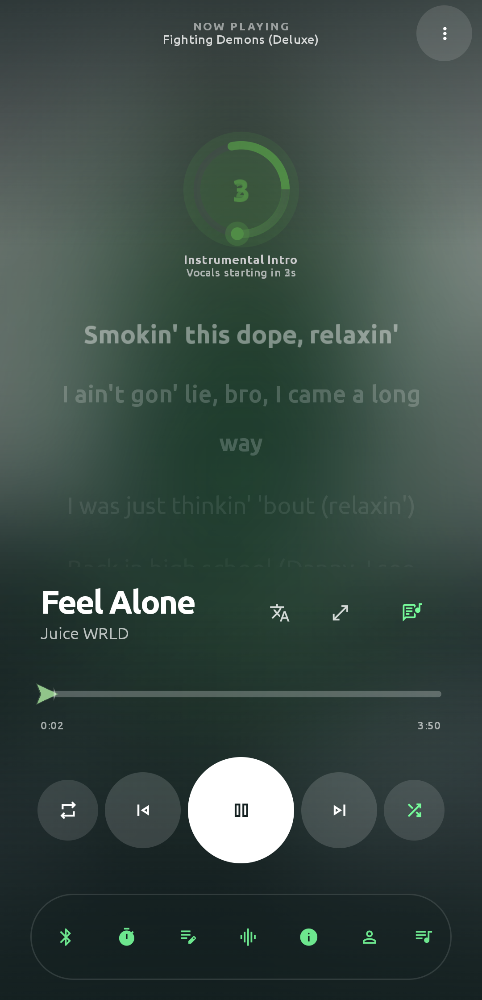
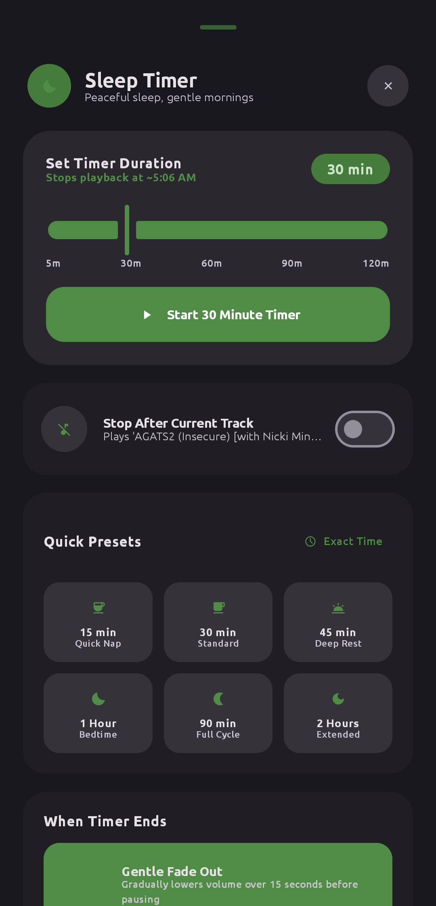
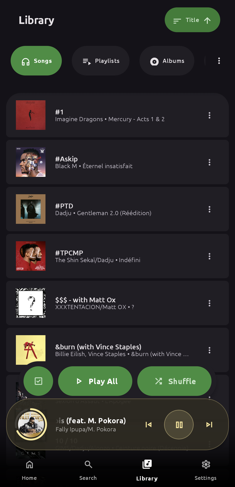
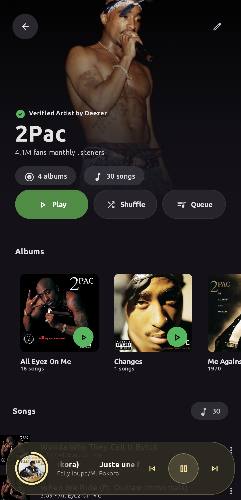
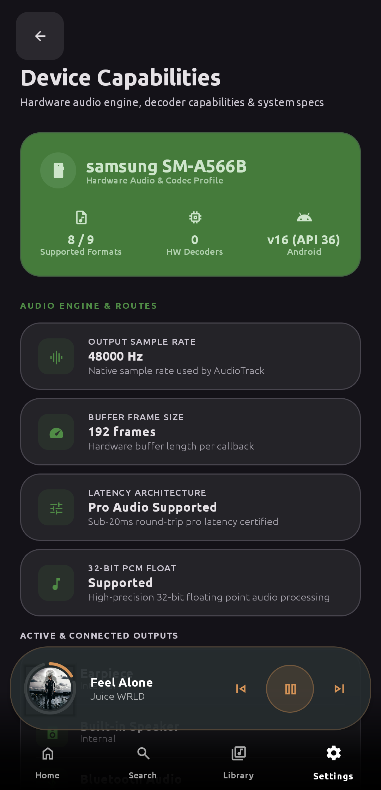
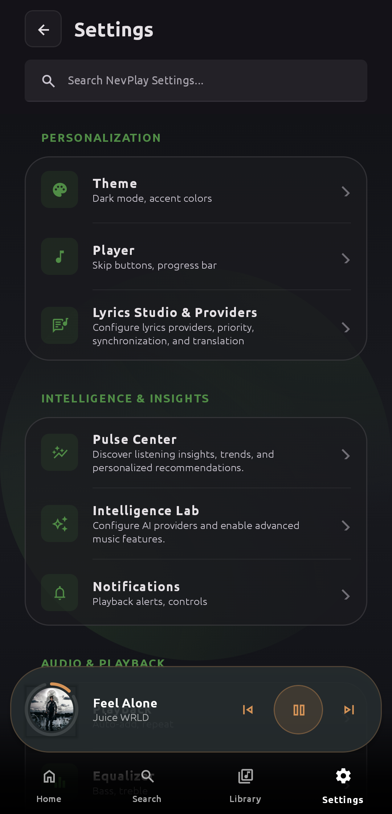
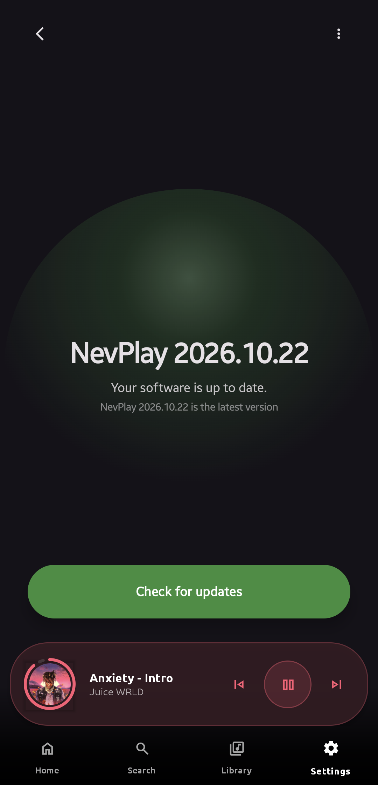

# NevPlay

### *The Dawn of a New Harmony.*
**A modern, premium, offline-first music experience powered by Material 3 Expressive & pro-grade acoustic DSP for Android.**

---

 

### 📥 **Get NevPlay Today**

  
  &nbsp;
  
  &nbsp;
  

  <a href="https://nevplay-music.vercel.app/"><strong>🌐 Official Website</strong></a> •
  <a href="https://github.com/nevanstudio/nevplay_releases/releases"><strong>📦 All Releases</strong></a> •
  <a href="https://discord.gg/XjPyUYPQYc"><strong>💬 Discord Community</strong></a> •
  <a href="https://t.me/NevPlaySupport"><strong>📢 Telegram Channel</strong></a>

---

## ✨ Why NevPlay?

NevPlay is an audiophile-grade, privacy-first local audio player designed specifically for modern Android. Built with a fluid **Liquid Glass** aesthetic, Jetpack Compose, and low-latency acoustic audio processors, NevPlay treats your local audio library with the craftsmanship and visual elegance it deserves.

- **100% Offline & Private** — No accounts, no data collection, no background tracking, and no cloud dependencies.
- **Audiophile DSP Engine** — Safe shelving Bass Boost, 3D Spatial Virtualizer, 10-band graphic equalizer, and AutoEQ correction database.
- **Karaoke-Style Synced Lyrics** — Syllable-accurate LRC synchronized lyrics with countdown lead-in ring and animated transitions.
- **Smart System Folder Protection** — Automatic default shielding of system ringtones, alarms, voice recordings, and Android system directories on internal storage and external SD cards.
- **Full Multi-Selection System** — Instant bulk actions across songs: multi-tag batch editor, bulk playlist creation, and safe device management.

---

## 📱 Screenshots Gallery

| Now Playing (Liquid Glass) | Synced Karaoke Lyrics | Interactive Lyrics Peek |
|:---:|:---:|:---:|
|  |  |  |
| *Album Art Dynamic Theming* | *Real-Time Synchronized Lyrics* | *Follow Lyrics in Player* |

 

| Redesigned Sleep Timer | Offline Music Library | Artist Discography |
|:---:|:---:|:---:|
|  |  |  |
| *Wavy Progress & Audio Fade* | *Multi-Select Action Deck* | *Albums, Top Tracks & Bio* |

 

| Hardware Audio Diagnostics | Material 3 Settings | In-App Direct Updater |
|:---:|:---:|:---:|
|  |  |  |
| *Audio Offload & Session Stats* | *Focus Folders & Blacklists* | *Instant Verified Updates* |

---

## 🚀 Key Features

### 🎧 **Pro Acoustic Engine**
- **Distortion-Free Bass Boost**: Custom IIR low-pass filter calibrated with safe shelving curves and a high-headroom soft-knee limiter, delivering rich, punchy low-end without audio saturation or clipping.
- **3D Spatial Virtualizer**: Mid/Side stereo widening tuned to psychoacoustic thresholds for immersive soundstaging without phase cancellation.
- **10-Band Graphic Equalizer**: Fine-grained frequency adjustments with custom presets (Rock, Pop, Jazz, Electronic, Bass Heavy).
- **AutoEQ Integration**: Instant access to thousands of community-calibrated parametric EQ correction curves for exact headphone models.
- **Pitch & Speed Shifter**: Variable speed from 0.5× to 2.0× and semitone pitch adjustment for rehearsal or audio exploration.

### 🎤 **Next-Gen Synced Lyrics**
- **Karaoke-Style LRC Sync**: Real-time line highlighting that glides seamlessly with your music.
- **Instrumental Break Lead-In**: Animated countdown ring and fluid entrance animations anticipating vocal sections.
- **Precision Timing Offset**: Adjust synchronization in millisecond increments on the fly.
- **Dual Display Modes**: Choose between immersive Full-Screen lyric stage or interactive Half-Sheet lyrics peek.

### 🌙 **Intelligent Bedtime Sleep Timer**
- **Live Countdown Hero**: Real-time animated `NevPlayWavyProgressLoader` displaying exact stop times.
- **Quick Extender Controls**: One-tap `−5m`, `+5m`, `+15m`, and `+30m` pills to adjust ongoing timers.
- **Stop After Current Track**: Let the song finish gracefully before ending playback.
- **Gentle 15-Second Audio Fade**: Gradually lowers volume so light sleepers are never jarred awake.
- **Wakelock Release**: Closes audio sessions and releases system locks overnight to conserve battery.

### 📁 **Library Management & Bulk Operations**
- **Universal Multi-Selection**: Long-press any track across Album, Artist, Playlist, Library, or Search to enter batch mode.
- **Batch Tag Editor**: Simultaneously update genre, artist, album, album artist, and year across multiple files.
- **Smart System Folder Blacklist**: Automatically excludes `Android`, `Ringtones`, `Alarms`, `Recordings`, and `Notifications` across both internal storage and external SD cards.
- **Focus Folders**: Switch between Blacklist and Whitelist scanning modes to tailor exactly which directories populate your library.
- **Set as Ringtone**: Directly configure any music track as your Android phone ringtone with verified permission flow.

### 🎨 **Material 3 Expressive Design**
- **Dynamic Theming**: Extracts vibrant tonal palettes directly from wallpaper or album artwork.
- **Liquid Glass Interface**: Translucent frosted cards, ambient glows, and butter-smooth 120 FPS transitions.
- **Customizable Shapes & Views**: Grid and List layouts with adaptive disc-art shapes.

---

## 🛠️ Tech Stack & Architecture

- **Language**: 100% Kotlin
- **UI Toolkit**: Jetpack Compose & Material 3 Expressive
- **Media Engine**: AndroidX Media3 (ExoPlayer) with custom zero-latency PCM audio processors
- **Concurrency**: Kotlin Coroutines & StateFlow / SharedFlow
- **Local Storage**: Room Database, SharedPreferences, MediaStore ContentResolver
- **Target OS**: Android 8.0 (API 26) through Android 16 (API 36)

---

## 🛡️ Privacy & Security Philosophy

NevPlay is architected with a strict **offline-first and privacy-respecting** design:

* **Zero Tracking & Analytics**: No third-party tracking SDKs, ad networks, or telemetry agents are embedded in the app.
* **Pure Local Execution**: All metadata parsing, playlist indexing, audio processing, and tag modifications take place entirely on-device.
* **Storage Access Framework (SAF)**: File operations strictly adhere to modern Android scoped storage and SAF guidelines, ensuring your personal files remain untouched and secure.
* **Network Independence**: NevPlay operates completely without an internet connection. Network calls are only initiated when the user explicitly checks for app updates or accesses optional online lyrics.

---

## 💬 Community, Feedback & Support

We continuously evolve NevPlay based on user feedback. Here is how you can connect with us:

* **In-App Issue & Feature Reporter**: Go to **Settings → Report Issue / Request Feature** directly inside the app to submit suggestions, bug reports, or feature requests with optional diagnostic info.
* **Discord Community**: Join our official [NevPlay Discord Server](https://discord.gg/XjPyUYPQYc) to chat with fellow music lovers, discuss audio setups, and get early previews.
* **Telegram Channel**: Subscribe to the [NevPlay Telegram Channel](https://t.me/NevPlaySupport) for release announcements, beta builds, and feature showcases.

---

## ❓ Frequently Asked Questions (FAQ)

<b>Does NevPlay support lossless audio formats?</b>

 
Yes! NevPlay supports a comprehensive range of audio formats including FLAC, ALAC, WAV, AIFF, OGG, Opus, AAC, and MP3, preserving bit-perfect audio delivery to your device's audio hardware.

<b>How does the automatic folder blacklist work?</b>

 
NevPlay shields non-music audio directories (`Android/`, `Ringtones/`, `Alarms/`, `Recordings/`, `Notifications/`) automatically on both internal storage and external SD cards so notification pings and voice notes do not clutter your song library. You can customize blacklisted and whitelisted folders anytime in Settings.

<b>How do in-app updates work?</b>

 
NevPlay features a built-in verified updater that checks the official releases API. You can choose between the <b>Stable</b> channel for thoroughly tested releases or the <b>Nightly</b> channel for the newest cutting-edge improvements.

<b>Why is my bass boost not distorting anymore?</b>

 
NevPlay includes a custom DSP audio processor with calibrated low-pass shelving and a 0.92 limiter threshold that prevents digital clipping and speaker saturation, allowing high bass levels without sound degradation.

---

## 📄 License & Copyright

**Copyright © 2026 Nevan Studio. All rights reserved.**

NevPlay is **proprietary software**. All code, graphical assets, UI components, sound designs, trademarks, and documentation are the exclusive intellectual property of **Nevan Studio**.

* **Redistribution**: Unauthorized distribution, redistribution, sublicensing, or public mirroring of application binaries or source files is strictly prohibited without prior written consent.
* **Modification**: Reverse engineering, decompilation, disassembly, or creation of derivative works from this application is strictly forbidden.
* **Commercial Use**: Use of NevPlay or any of its proprietary components for commercial gain or embedding into other applications is prohibited.

For inquiries or licensing questions, please reach out via our [official community channels](https://discord.gg/XjPyUYPQYc).

   
  Crafted with passion for pure sound by <a href="https://github.com/nevanstudio">Nevan Studio</a>.

